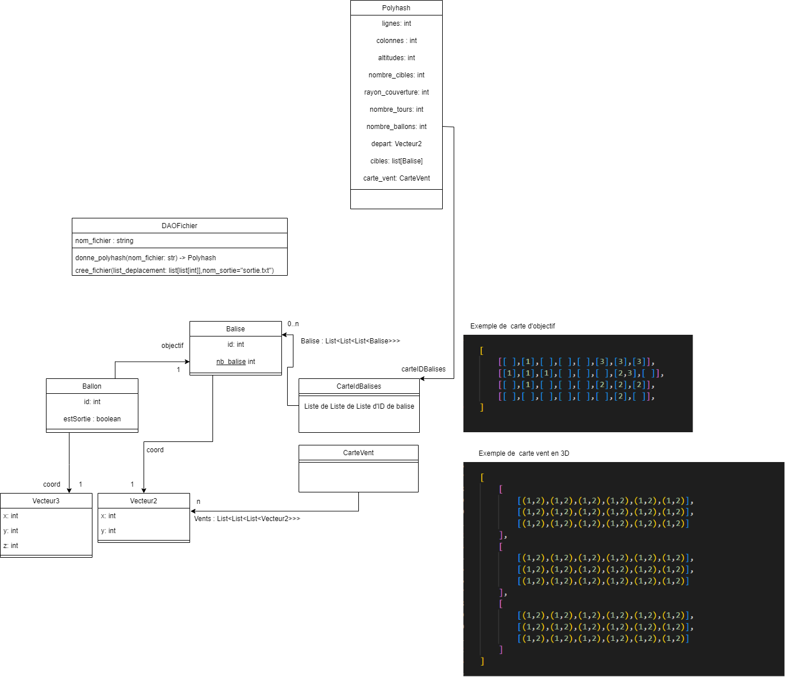

# PolyHash-24 EQUIPE B : BLACK HAT

Ce dépôt correspond au projet informatique de troisième années de Polytech Nantes.

## Étudiants : 
- Augustin BERNARD - augustin.bernard@etu.univ-nantes.fr
- Roudy HAJO - roudy.hajo@etu.univ-nantes.fr
- Bryan LEVY - bryan.levy@etu.univ-nantes.fr
- Coralie TOSTEN - coralie.tosten@etu.univ-nantes.fr

Ce dépôt correspond au projet informatique de troisième année de 4 étudiants de Polytech Nantes.

## Consigne d'exécution du projet

Commencez par clone ce dépôt :  
```shell
git clone https://gitlab.univ-nantes.fr/E224508F/polyhash-24.git
```

Le fichier **main.py** permet le lancement des différentes stratégies, l'affichage de leur score sur un fichier de données et l'enregistrement du meilleure score.

Pour cela, il y a 2 possibilités pour lancer **main.py** : 
```shell
python main.py chemin/fichier_entree.txt chemin/fichier_sortie.txt 
```
Où `chemin/fichier_entree.txt` désigne le fichier de données d'entrée 
et `chemin/fichier_sortie.txt` désigne le chemin du fichier où sera enregistrer la solution 

Les fichiers de données sont stockés dans `data/` 
Il est alors possible de seulement préciser le fichier de sortie tel que : 
```shell
python main.py chemin/fichier_sortie.txt
```
La liste des fichiers stockés dans **data/** sera alors listée et il suffira alors d'entrer le numéro du fichier correspondant.

Exemple pour choisir le fichier `d_final.in` : 
```
0 - a_example.in  
1 - b_small.in
2 - c_medium.in
3 - d_final.in

>> 3
```

Pour obtenir un comparatif entre les différentes stratégies, il vous faut lancer le fichier `affichage.py`. Avant cela, installez les deux packages suivants :

Pour analyser la mémoire :
```shell
pip install pympler
```

Pour l'affichage des résultats sous forme de tableau :
```shell
pip install tabulate
```

Enfin, pour lancer le fichier
```shell
python affichage.py
```

Vous avez un exemple de la sortie de ce fichier dans <a href="affichage.md">affichage.md</a>

## Organisation du git 

### Dossier Strategies/

Dans ce dossier est stocké les différentes stratégie que l'on a développé

Toute stratégie hérite de la classe **StrategieInterface** :
Cette interface définit 2 méthodes que doit utiliser chaque Stratégie.
```python
class StrategieInterface:
    def initialisation(self,polyhash : Polyhash):
        pass
    def donne_action(self, ballon) -> int:
        """entrée : un ballon et les données du polyhash
           sortie : l'action à effectuer pour un tour pour un ballon"""
        pass
```

La fonction **initialisation** est appeler au début du lancement du jeu et permet d'initialiser les données de la stratégie à 0

La fonction **donne_action** quant à elle renvoie l'action à effectuer pour un ballon en particulier à un instant précis.
Elle pourra renvoyé -1, 0 ou 1


# Analyse du projet

Avant de commencer le développement du projet nous avons démarré par une partie analyse.
Nous avons commencé par la création d'un diagramme de classe permettant de décrire l'idée général de comment sera implémenter notre projet / et organisé.




## Description général du projet 

**Polyhash** est un projet inspiré d'un défi proposé par Google. L'objectif est de développer des stratégies optimales pour piloter des ballons au sein d'un espace tridimensionnel modélisé par une carte des vents.

La carte des vents est composée de cellules, chacune contenant un vecteur bidimensionnel représentant le déplacement causé par les courants aériens. Une liste de balises doit être couverte par les ballons, en maximisant à la fois le nombre de balises atteintes et le temps pendant lequel elles sont couvertes.

À disposition, nous avons une quantité de ballons qui peuvent effectuer différentes actions :

Se déployer pour commencer à naviguer,
Monter ou descendre pour changer d'altitude et modifier leur trajectoire en fonction des vents,
Rester immobiles en maintenant leur altitude actuelle.

Le défi consiste à concevoir des stratégies pour définir les actions des ballons à chaque étape. Ces stratégies doivent exploiter les vecteurs des vents pour guider efficacement les ballons vers les balises tout en minimisant les mouvements inutiles.

## Assignation des taches :
| Augustin                                                                                                              | Bryan                                                     | Coralie                                                                       | Roudy                                                                         |
|-----------------------------------------------------------------------------------------------------------------------|-----------------------------------------------------------|-------------------------------------------------------------------------------|-------------------------------------------------------------------------------|
| Travail théorique sur la résolution du problème <br>  (carte ID balises, décalage des ballons, système de clustering) | Organisation du git                                       | Création de la classe Jeu permettant d'exécuter une partie avec une Stratégie | Création du DAO à partir du fichier d'entrée et écriture du fichier de sortie |
| Premier prototype de la stratégie A star + clustering                                                                 | Stratégie Aléatoire / Mutation et A star                  | Stratégie Proche                                                              | Travail sur le clustering et carte ID balises                                 |
| Implémentation des stratégies par ligne                                                                               | Création visualisation de la carte et des ballons/balises | Calcul de la complexité spatiale et du temps d'exécution de chaque stratégie. | Stratégie un ballon par altitude et stratégie arbre (Brute Force)             |


## Similarités des différentes stratégies

**Carte ID balises :** Carte créée au tout début de l'éxecution sur laquelle chaque case contient une liste des balises dont le rayon de couverture est dans la case (utile pour calculer le score ou les clusters).

**Interval entre les ballons :** On ne déploie le ballon uniquement si son id multiplié par un interval de déploiement est inferieur au tour actuel.

## Stratégies utilisées :

### - Un ballon par altitude
Répartir les ballons en affectant à chaque ballon une altitude.

### - A star + clustering
Regroupement des balises en clusters à l'aide d'une carte contenant les ID des balises dans chaque cases du rayon de couverture de celles-ci. Sélection des meilleures clusters en fonction du nombre de balises a l'interieur. Affectation des clusters dans l'ordre croissant des scores à chaque ballon. Recherche des clusters pour chaque ballon. Puis utilisation de la stratégie A star pour que ces ballons se dirigent vers leur balise associé et y restent.

**Efficacité** : Efficace sur les premières solutions, assez peu efficace sur la solution_d étant donné son aspect unidirectionnel.

Complexité :

### - Stratégie Aléatoire
Stratégie par force brute dans laquelle chaque ballon décide de prendre une direction aléatoire et on ne garde que le meilleur score.

**Efficacité** : Assez efficace sur le long terme, peu efficace si on doit souvent changer de carte.

**Complexité** : Extremement long pour trouver un bon score (270 000 sur la solution d en quelques heures)<br>

Pour cette stratégie, il faut lancer **rechercheAleatoire.py**

```shell
py rechercheAleatoire.py chemin/fichier_sortie.txt
py rechercheAleatoire.py chemin/fichier_entree.txt chemin/fichier_sortie.txt

```

### - Stratégie Proche
Chaque ballon est assignée à une balise qui devient son objectif, les balises sont choisis par distance : la cible du premier ballon est la balise la plus proche, celle du deuxième, la deuxième cible la plus proche. Tous les ballons ont donc des objectifs différents. A chaque tour le ballon se déplace en fonction de la distance entre lui et sa cible (il prend la plus proche).

**Efficacité** : Asszez efficace sur les petites cartes mais pas sur la carte_d.

Conplexité : 

### - Stratégie Aléatoire Evolutive Variée
Même principe que pour la stratégie aléatoire mais pour éviter les redondances entre les solutions, on prend en compte la liste des ordres donnés aux ballons et on la modifie légèrement (avec une probabilité pour chaque ordre, qu'il change). Evolutive car on ne garde que la meilleure des listes d'ordres. Variée car on commence par des générations differentes afin d'avoir moins de chance de commencer par une liste d'ordre qui n'amène à rien.


**Efficacité** : Efficace sur le long terme, peu efficace si on doit souvent changer de carte. (**300 000 en moins d'une minute**, 400 000 en quelques heures, sur la carte_d)

**Complexité** : Beaucoup plus rapide que la stratégie aléatoire car on évite les redondances.

Pour cette stratégie, il faut lancer **rechercheAleatoire.py**

```shell
py rechercheAleatoireMutation.py chemin/fichier_sortie.txt
py rechercheAleatoireMutation.py chemin/fichier_entree.txt chemin/fichier_sortie.txt

```

### - Stratégie Ligne
Stratégie assez basique reprenant le principe de la stratégie proche mais en ne visant qu'une coordonnée y précise, qui prend en arguments le numéro d'une ligne ainsi qu'un interval de déploiement entre les ballons. Cette stratégie a été pensée pour la carte_d (Les ballons vont vers l'Est en permanence et les balises de la carte d sont surtout regroupées vers le Nord).

**Efficacité** : Assez efficace pour une stratégie basique (**277 000** sur la carte_d à la ligne 15 et avec un interval de 80)

**Complexité** : Linéaire (5 secondes)

### - Stratégie Double Ligne
Même principe que la stratégie ligne mais on associe plusieurs lignes en fonction des ballons pairs et impairs.

**Efficacité** : Très efficace sur la carte_d (**320 000** sur la carte_d à la ligne 10 et 30 et avec un interval de 40).

**Complexité** : Linéaire (5 secondes)

### - Stratégie Triple Ligne
Même principe que la double ligne mais 3 lignes, on coupe également les lignes en 3 pour chaque continent (Amérique, Afrique et Australie) ce qui donne 3 lignes à suivre par ballons en fonction de leur position en x et donc 9 lignes en tout.

**Efficacité** : Extremement efficace sur la carte_d (**432 000** sur la carte_d)

**Complexité** : Linéaire (5 secondes)

-> **Solution très efficace**, il ne reste plus qu'a adapter la fonction pour faire varier les paramètres et le nombre de lignes.


### - Stratégie Arbre

Cette stratégie construit un arbre où chaque nœud représente une action possible (-1, 0, 1) et cumule un score depuis la racine. La profondeur de l'arbre correspond au nombre de tours.

Les feuilles sont triées par score, et le chemin optimal est construit en remontant de la meilleure feuille à la racine. Les scores des nœuds sont ensuite mis à jour pour intégrer les balises couvertes.

**Efficacité** : Cette méthode trouve les chemins optimaux.

**Complexité** : Croît exponentiellement avec la profondeur, rendant la stratégie inefficace pour des fichiers comme c_medium.